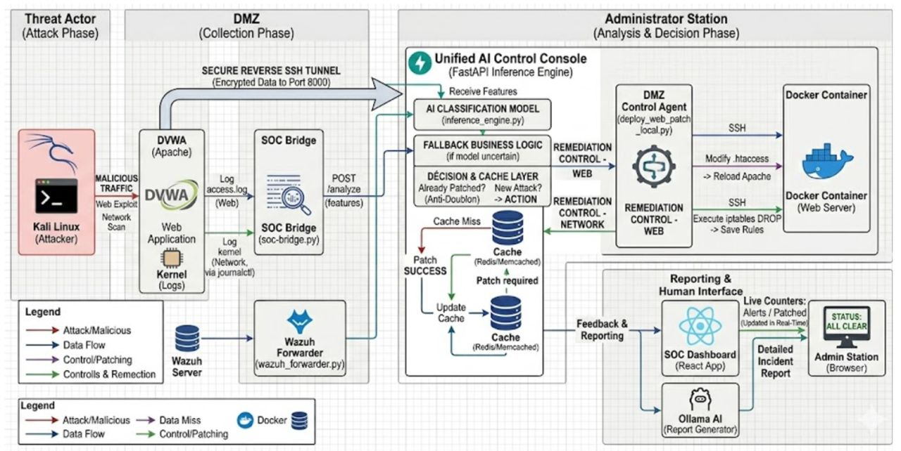

# 🔐 AutoGuard-AI

### SOC hybride intelligent pour la détection des menaces et la réponse automatisée aux incidents
ntelligence artificielle · Cybersécurité · DevSecOps · SIEM · Automatisation

---

## 📌 Présentation du projet

**AutoGuard-AI** est une plateforme de Security Operations Center (SOC) hybride qui combine l'intelligence artificielle, le Machine Learning, la surveillance SIEM et les pratiques DevSecOps afin de renforcer la détection, l'analyse et la réponse aux cybermenaces.

Le projet vise à mettre en place une chaîne de sécurité intégrée capable de collecter et corréler les événements, classifier les activités malveillantes, générer des rapports intelligents et déclencher des mécanismes automatisés de remédiation.

La plateforme repose sur une infrastructure réseau segmentée et une architecture modulaire qui relie les composants de détection, d'analyse et de remédiation.

## 🎯 Objectifs

- Centraliser la collecte et la surveillance des événements de sécurité.
- Détecter et classifier les activités malveillantes grâce au Machine Learning.
- Exploiter un moteur d'analyse basé sur FastAPI pour traiter les alertes.
- Utiliser un LLM local pour générer des rapports d'investigation.
- Automatiser certaines actions de réponse aux incidents.
- Sécuriser le cycle de développement grâce à une chaîne DevSecOps.
- Renforcer l'isolation réseau à travers une architecture segmentée.

## 🏗️ Architecture globale

La plateforme est organisée autour de quatre composants principaux :

### 1. Infrastructure réseau sécurisée

L'infrastructure repose sur **pfSense** pour assurer la segmentation réseau et le contrôle des communications entre les différentes zones.

- **SOCNET :** hébergement des composants de surveillance, d'analyse et d'intelligence artificielle.
- **DMZNET :** hébergement des applications exposées et des services de test.
- **REDNET :** environnement dédié aux activités de simulation d'attaques et de tests de sécurité.

Cette segmentation permet de limiter les communications entre les différentes zones et de renforcer l'isolation des composants.

### 2. SOC intelligent et détection des menaces

Cette couche assure la collecte, l'analyse et la classification des événements de sécurité.

- **Wazuh SIEM :** collecte et surveillance des événements, détection et corrélation des alertes.
- **Machine Learning :** modèles entraînés sur le jeu de données CIC-IDS2018 pour identifier et classifier les activités malveillantes.
- **FastAPI :** moteur de décision chargé de traiter les événements et de fournir les résultats d'analyse.
- **Ollama :** exécution locale d'un LLM pour produire des rapports de sécurité à partir des résultats d'analyse.
- **SOC Dashboard :** visualisation des alertes et suivi des incidents.

### 3. Remédiation automatisée – Virtual Patching

AutoGuard-AI intègre un mécanisme de réponse automatisée permettant de déclencher des actions de mitigation selon la nature de la menace détectée.

**Remédiation Web :**

- Génération et application dynamique de règles `.htaccess`.
- Blocage des requêtes web identifiées comme malveillantes.

**Remédiation réseau :**

- Isolation des sources malveillantes à l'aide de règles `iptables`.
- Application de mesures de blocage au niveau réseau.

**Communication et validation :**

- Composant Bridge assurant la communication entre le SOC et les mécanismes de remédiation.
- Validation des actions appliquées afin de vérifier leur exécution.

### 4. Pipeline DevSecOps

Une chaîne CI/CD intégrant plusieurs outils de sécurité permet de contrôler la qualité et la sécurité du code tout au long du cycle de développement.

| Outil           | Fonction                                  |
| --------------- | ----------------------------------------- |
| GitHub Actions  | Automatisation du pipeline CI/CD          |
| SonarQube       | Analyse statique du code (SAST)           |
| Trivy           | Analyse des vulnérabilités des conteneurs |
| OWASP ZAP       | Tests dynamiques de sécurité (DAST)       |
| HashiCorp Vault | Gestion sécurisée des secrets             |

## 🔄 Fonctionnement global

Le fonctionnement de la plateforme suit une chaîne de traitement en plusieurs étapes :

1. **Collecte :** Wazuh récupère les événements et les journaux provenant de l'infrastructure surveillée.
2. **Détection :** les événements suspects sont identifiés et les alertes sont générées.
3. **Analyse :** les données sont transmises au moteur FastAPI pour être traitées par les modèles de Machine Learning.
4. **Classification :** le moteur identifie la catégorie de menace et fournit les résultats de l'analyse.
5. **Enrichissement :** un LLM local exécuté avec Ollama génère un rapport d'analyse compréhensible.
6. **Remédiation :** les mécanismes de réponse appliquent les actions de mitigation adaptées.
7. **Validation :** les actions de remédiation sont vérifiées et les résultats sont visualisés sur le tableau de bord SOC.

## 🧰 Technologies utilisées

### Cybersécurité & SIEM

`Wazuh` `pfSense` `iptables` `Virtual Patching` `OWASP ZAP`

### Intelligence artificielle & Machine Learning

`Python` `Machine Learning` `CIC-IDS2018` `Ollama` `LLM`

### Développement & API

`FastAPI` `Python` `REST API`

### DevSecOps & CI/CD

`GitHub Actions` `SonarQube` `Trivy` `HashiCorp Vault` `Docker`

### Infrastructure & Réseau

`Linux` `Apache` `.htaccess` `pfSense` `iptables`

## 📊 Résultats et réalisations

Le projet a permis de concevoir une plateforme intégrant :

- Une architecture SOC hybride avec surveillance centralisée via Wazuh.
- Une détection et une classification des attaques basées sur le Machine Learning.
- Un moteur d'analyse et de décision exposé via FastAPI.
- Une génération locale de rapports de sécurité grâce à un LLM.
- Des mécanismes de remédiation automatisée au niveau Web et réseau.
- Une chaîne DevSecOps intégrant plusieurs contrôles de sécurité.
- Une infrastructure réseau segmentée et supervisée.

## 🖥️ Démonstration

Les captures d'écran et les démonstrations de la plateforme seront ajoutées dans cette section.

**Éléments à illustrer :**

- Architecture réseau et segmentation pfSense.
- Tableau de bord de surveillance Wazuh.
- Détection et classification des attaques.
- Rapports générés par Ollama.
- Exécution et validation des actions de remédiation.
- Résultats du pipeline DevSecOps.

## 🚀 Perspectives d'amélioration

- Enrichissement de la détection par des mécanismes de Threat Intelligence.
- Amélioration de la précision des modèles de Machine Learning.
- Extension des scénarios de réponse automatisée.
- Renforcement de la validation et du contrôle des actions de remédiation.
- Intégration de nouveaux mécanismes d'analyse assistés par IA.

---

\

&#x20; 🔐 \<strong>AutoGuard-AI\</strong>\ 
&#x20; Vers un SOC intelligent, automatisé et sécurisé.
\

---

## 🏗️ Architecture globale du projet

Le schéma suivant présente l'architecture d'AutoGuard-AI, les différentes zones réseau ainsi que les interactions entre les composants de détection, d'analyse et de remédiation.

  

